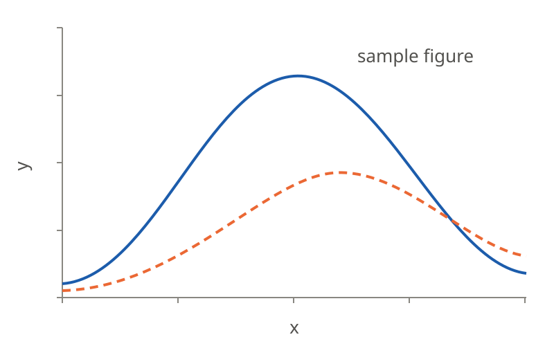

<!-- _class: title -->

# 発表タイトル

## サブタイトル（なければこの行を消す）

20XX 年 X 月 X 日
○○研究室　B4　名前

---

# 目次

1. 背景と目的
2. 方法
3. 結果
4. まとめと今後の予定

---

<!-- _class: chapter -->

# 1. 背景と目的

---

# 箇条書き

- スライドは `---` で区切る。`#` がスライドのタイトルになる
- 大事なところは `**強調**` で **強調** する
- 字下げすると 2 段目になる
  - 2 段目は少し小さい字になる
- 番号をつけるときは `1.` `2.` と書く

<!-- このような、クラスの指定以外のコメントは発表者ノートになる（スライドには出ない）。 -->

---

<!-- _class: fig -->

# 図



図 1: 図の説明。`fig` クラスのスライドでは、図が中央に、下の文がキャプションになる

<!-- 図はコピーせず、experiments/<名前>/fig/ の図を相対パスで参照する（例: ../../experiments/xxx/fig/yyy.png）。 -->

---

# 図と文を左右に並べる


- `` と書くと、図が右側に入る
- 文は残った左側に収まる
- `48%` は図に使う幅。`left` にすると図が左側に入る
- 図の大きさは `w:600`（幅）や `h:400`（高さ）でも指定できる

---

# 数式

文の中の数式は `$...$`、独立した数式は `$$...$$` で囲んで LaTeX の記法で書く。

$N$ 回の測定値 $x_i$ の平均 $\bar{x}$ と標準偏差 $\sigma$ は次のとおり。

$$
\bar{x} = \frac{1}{N} \sum_{i=1}^{N} x_i, \qquad
\sigma = \sqrt{\frac{1}{N-1} \sum_{i=1}^{N} \left( x_i - \bar{x} \right)^2}
$$

---

# 表

| 条件 | 回数 | 平均 | 標準偏差 |
| --- | ---: | ---: | ---: |
| A | 5 | 1.234 | 0.012 |
| B | 10 | 12.345 | 0.105 |

- 列の区切りの行を `---:` にすると右寄せ、`:---:` にすると中央寄せになる
- 数値の列は右寄せにして桁をそろえる

---

# 入力ファイルやコード

設定ファイルの例（`experiments/xxx/in/config.txt`）

```text
# 条件
temperature   300      # K
steps         1000
output        data/result.csv
```

- 3 つのバッククォートで囲むと、コードとして等幅で表示される
- 長いものは全部載せず、説明に要る行だけ抜き出す

---

# 出典や注を下に書く

- 行の先頭に `>` をつけた文は、スライドの下端に小さく出る
- 図や式を資料から引用したときは、そのスライドに出典を書く

> 出典: 著者名, 雑誌名, 巻, ページ（年）

---

# まとめ

- わかったことを 2〜3 点にまとめる
- 数値や図で示したことを、文で言い直す

## 今後の予定

- 次にやることを書く

---

<!-- _class: small -->

# 参考文献

1. 著者名, 雑誌名, 巻, ページ（年）
2. 著者名「タイトル」資料名（年）
3. `small` クラスのスライドは全体の文字が小さくなる。項目が多いときに使う

<!-- 書誌情報は references/references.bib から写す。 -->
